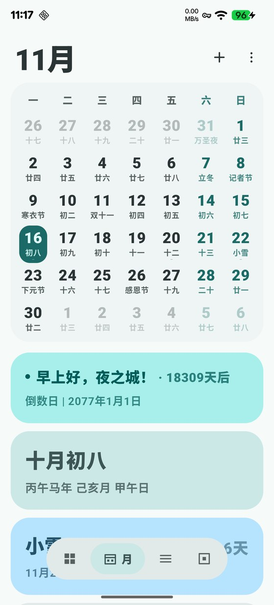
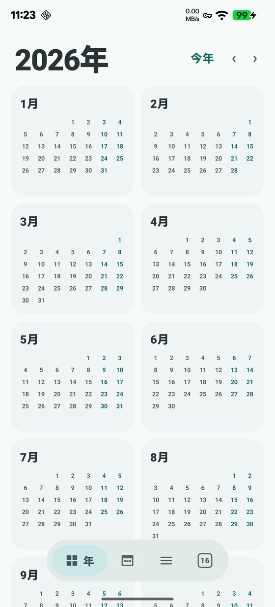
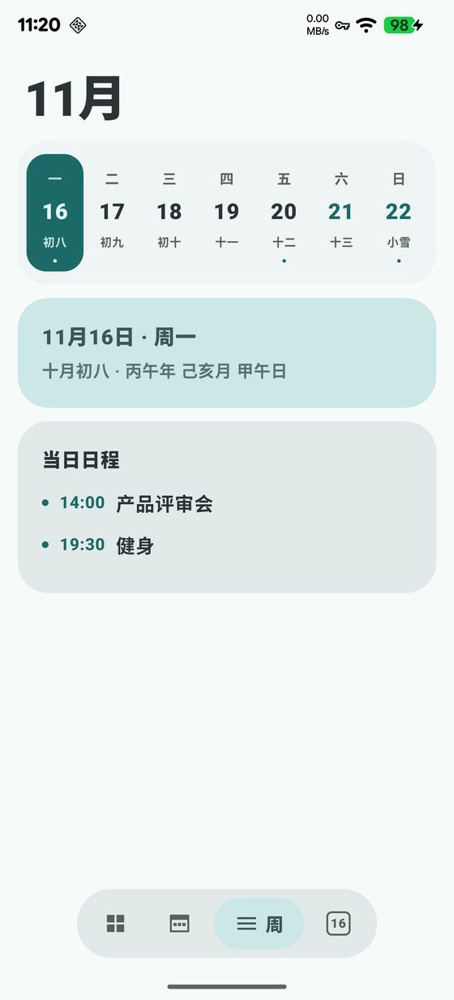
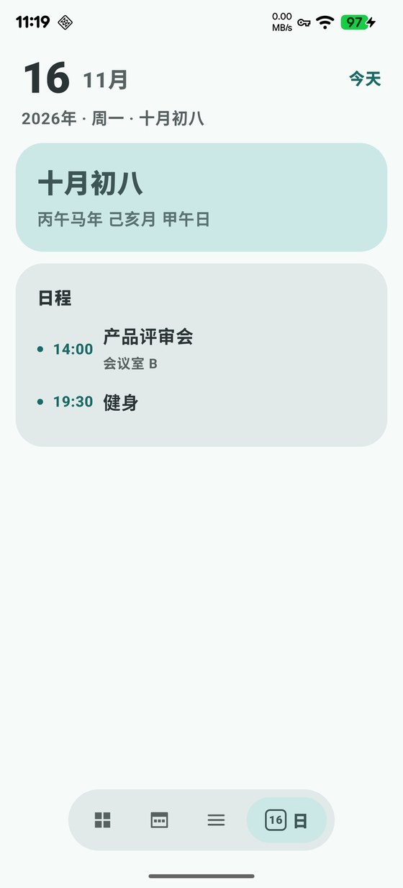
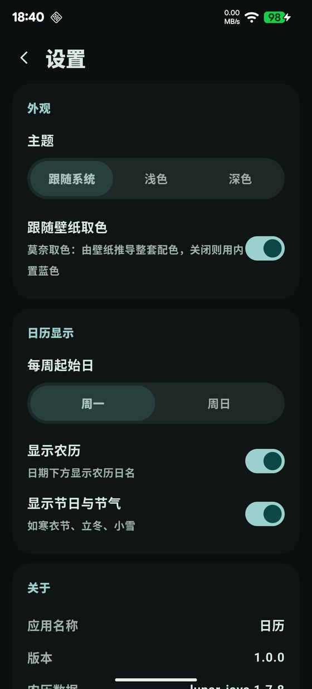

# 日历 · Material You 风格的开源中文日历

一个纯 Jetpack Compose 写的中文日历 App。MD3（Material You / 莫奈取色）风格，带农历、节气、干支、
法定节假日调休、日程提醒和倒数日。

**它主要就解决一件事情：Material You 风格的开源中文日历，基本上没有。**

---

## 为什么会有这个项目

想给自己的手机找一个 MD3 风格的日历，翻了一圈 GitHub，能找到的开源日历大概分两类：

一类是谷歌日历那种——每个日期是个大方块，事件往里塞彩色条条，信息密度全堆在格子里；
另一类是日期选择组件库，只提供组件，不是能装的 App。

这两种都不是我想要的。我想要的是国内日历 App 那种做法：

- 月历格子里**只有文字**：上面一个大号数字，下面一行小字写农历 / 节气 / 节日，没有任何边框和底色块
- 农历和节日直接写在格子里，不用点开才知道
- 今天用一个小圆角色块标出来，周末的数字换个颜色
- 事件不往格子里塞，只在日期下面点一个小圆点，详情下放到下面的卡片里

（这种风格具体叫什么我也不知道，反正国内日历 App 基本都长这样。）

能同时满足「这种排版」和「MD3 风格」的开源项目，我确实没找到。所以自己写了一个。

---

## 它长什么样

| 月视图 | 年视图 |
|---|---|
|  |  |

| 周视图 | 日视图 | 深色 · 设置 |
|---|---|---|
|  |  |  |

> 截图里的青绿色不是写死的，是从手机壁纸取的色——换张壁纸整个 App 会跟着变。

---

## 能干什么

### 日历

- **月 / 周 / 日 / 年** 四个视图
- 月历格子：大号日期 + 农历日名 / 节气 / 节日
- 农历节日不只有春节中秋，**寒衣节、下元节、龙抬头**这些也有
- 24 节气全年（立冬、小雪、冬至……）
- 干支纪年 / 月 / 日 + 生肖（十月初八 · 丙午马年 己亥月 甲午日 这种）
- **2026 年法定节假日与调休**，调休上班那天小字标红「班」
- 每周起始日可选周一 / 周日
- 农历、节日显示可以单独关掉

### 日程

- 新建 / 编辑 / 删除，可以填时间、备注
- **提醒**：准时 / 提前 10 分钟 / 30 分钟 / 1 小时
- 重启手机后提醒会自动恢复（重新排闹钟）
- 月历格子上事件显示为一个小圆点

### 倒数日

- 距离目标日期还有多少天，支持新建 / 编辑 / 删除

### 外观

- **真·莫奈取色**：Android 12+ 直接用系统从壁纸推导的整套 Material You 配色，不是自己瞎调的
- 深色模式跟随系统，也可以强制浅色 / 深色
- 应用图标支持 **monochrome 图层**，Android 13+ 开"主题图标"会跟壁纸变色
- 全程没有毛玻璃 / 半透明效果（个人不喜欢）

---

## 技术栈

| 部分 | 用的什么 |
|---|---|
| 语言 / UI | Kotlin + Jetpack Compose（没有任何一行 View 系统代码） |
| 设计系统 | `androidx.compose.material3` |
| 配色 | `dynamicLightColorScheme` / `dynamicDarkColorScheme`，直接吃系统壁纸取色 |
| 农历节气干支 | [`cn.6tail:lunar`](https://github.com/6tail/lunar-java)（lunar-java，MIT） |
| 提醒 | `AlarmManager.setExactAndAllowWhileIdle`，无精确闹钟权限时自动降级 |
| 本地存储 | SharedPreferences + JSON（数据量很小，没上 Room） |
| 最低版本 | **Android 12（API 31）** |

为什么 minSdk 是 31：动态取色要 31 才原生支持，定在这条线上就不用写一堆 `Build.VERSION.SDK_INT`
判断，也不用给老版本准备降级色板。代价是老机器装不了，我觉得这个取舍划算。

构建环境（我用的）：

```
AGP 9.3.1 · Gradle 9.7.0 · Kotlin 2.4.20 · Compose BOM 2026.09.00 · compileSdk 37
```

---

## 自己编译

**如果你只是想用，别自己编译**，直接去 [Releases](../../releases/latest) 下 APK 装上就行。

想改代码的话：

```bash
git clone https://github.com/sangsheng2026/md3-calendar.git
cd md3-calendar
./gradlew assembleDebug
```

产物：`app/build/outputs/apk/debug/app-debug.apk`

需要准备：

- **JDK 17 或更高**（我用 21）
- **Android SDK 的 compileSdk 37** 平台包
- Android Studio 版本别太老（AGP 9 是比较新的）

---

## 已知限制

这些不是 bug，是还没做或者故意不做的：

- **调休数据写死在 2026 年**（`lunar/OfficialHolidays.kt`）。国务院每年 11 月左右公布下一年的安排，
  到时候得手动补。跨年之后不会崩，只是没有调休标记。
- 日程**没有重复规则**（每周 / 每月），目前只有单次提醒。
- 没有订阅日历、没有 ICS 导入导出。
- 没有桌面小组件（想做，还没动）。
- 数据只存在本机，**没有云同步**。也不打算加——不想为了同步强迫用户注册账号。

---

## 致谢

- [lunar-java](https://github.com/6tail/lunar-java) —— 农历、节气、干支、传统节日的数据和算法全靠它
- AndroidX / Material 3 团队
- 排版思路参考了国内几款日历 App 的观感，但代码、图标、配色方案都是这个项目自己画/写的

---

## License

[MIT](LICENSE)